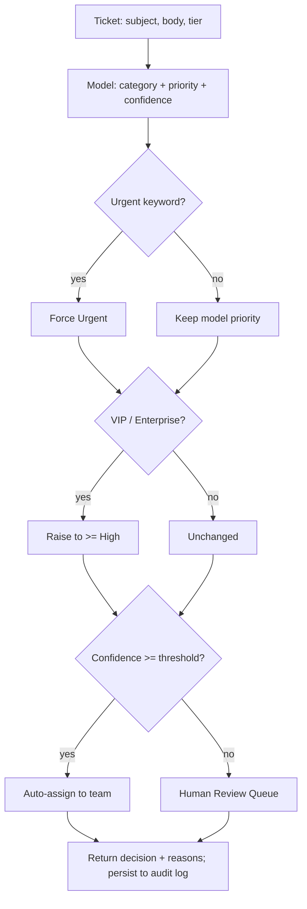

# Customer Support Ticket Triage System

Automatically **classifies, prioritizes, and routes** incoming support tickets — with an explainable decision path and a human-in-the-loop override.

> **Status:** v1.0.0 · 24 passing tests
> **Stack:** Python 3.11+ (tested on 3.13), FastAPI, Streamlit, scikit-learn, SQLite

---

## Business Problem

A mid-size SaaS company triages inbound support tickets by hand. A rotating agent reads each ticket, guesses the category, assigns a priority, and forwards it to a team. The process is **slow** (tickets wait in a single queue), **inconsistent** (different agents route the same ticket differently), and **hard to audit** (no record of *why* a ticket went where it did). Urgent, revenue-impacting tickets from top-tier customers sometimes sit behind low-priority ones.

## Outcome

This system triages a ticket in milliseconds, returns a **category, priority, and owning team** with a **confidence score and a plain-English reason for every decision**, and escalates automatically when a VIP customer or an urgent keyword is involved. When the model is not confident enough, it routes to a **Human Review Queue** instead of guessing. Every decision and every human override is persisted as an **audit trail** that also feeds the metrics and a future retraining loop.

The metric we optimize is **high-priority recall** — never letting a genuinely urgent ticket be under-prioritized — while maximizing **auto-containment** (tickets handled without human touch).

## Primary Users

| User | What they need |
|---|---|
| **Support agent** (business user) | A ready-sorted queue; a one-click override when the system is wrong. |
| **Support operations lead** (admin) | Visibility into volume, routing quality, override rate, and the review backlog. |
| **Engineering / security** | Reliability, input validation, optional auth, correlation IDs, and a clear line between current scope and production hardening. |

---

## Architecture

See [`docs/architecture.md`](docs/architecture.md) for the full set of diagrams. The decision pipeline:



**Key idea:** a scikit-learn model *proposes*, and a small deterministic rule layer *disposes*. The model gives us flexible text classification and explainability; the rules give us auditable, non-negotiable guardrails (VIP customers and urgent keywords always escalate).

---

## Features

- **Explainable decisions** — each result lists the model's top token signals, which rules fired, and the routing rationale.
- **Rule guardrails** — VIP/Enterprise tickets get a guaranteed priority floor; urgent keywords force `Urgent`. Rules can only *raise* priority, never lower it.
- **Low-confidence exception path** — below the confidence threshold, tickets go to a Human Review Queue instead of being auto-assigned.
- **Closed feedback loop** — operator overrides are captured as labeled feedback for future retraining.
- **Audit trail** — every decision and override is persisted with inputs, confidence, reasons, timestamps, and a correlation ID.
- **Operator console** — a Streamlit UI to triage a ticket, work the queue, override, and view metrics.
- **Optional API-key auth**, `/health` with dependency checks, and useful validation errors.

---

## Demo

A 60–90s walkthrough: submit a ticket → see the explainable decision → work the queue → override a wrong call → watch the metrics update.

```
screenshots/        <- add your captured screenshots here
  01-architecture.png
  02-triage.png
  03-explanation.png
  04-human-review.png
  05-metrics.png
```

> To capture screenshots: run the API and the Streamlit console (below), then screenshot each tab. The architecture diagram renders directly from the Mermaid block above.

---

## Setup

```powershell
# Windows PowerShell
python -m venv .venv
.venv\Scripts\Activate.ps1
python -m pip install --upgrade pip
pip install -r requirements.txt
copy .env.example .env
```

```bash
# macOS / Linux
python -m venv .venv
source .venv/bin/activate
python -m pip install --upgrade pip
pip install -r requirements.txt
cp .env.example .env
```

### Generate data, train, and (optionally) seed the demo

```bash
python -m data.generate_data --rows 600     # writes data/tickets.csv (synthetic)
python -m scripts.train                      # trains model + prints held-out metrics
python -m scripts.seed_demo                  # optional: populate the queue with sample tickets
```

### Run it

```bash
# Terminal 1 — API
uvicorn app.api.main:app --reload
#   docs at http://localhost:8000/docs

# Terminal 2 — operator console
streamlit run app/ui/streamlit_app.py
```

---

## API / Workflow

| Method | Path | Purpose |
|---|---|---|
| `GET` | `/health` | Liveness + checks that the model is loaded and the DB is reachable. |
| `POST` | `/triage` | Classify, prioritize, and route one ticket; returns the explainable decision. |
| `POST` | `/feedback` | Record a human correction (flagged as an override when it differs). |
| `GET` | `/metrics` | Workflow metrics from the audit log. |
| `GET` | `/queue` | Recent triaged tickets (powers the UI). |

Example:

```bash
curl -X POST http://localhost:8000/triage \
  -H "Content-Type: application/json" \
  -d '{"subject":"Production API is down","body":"500s for 20 minutes","customer_tier":"Enterprise"}'
```

```json
{
  "ticket_id": "T-d07fbf2a",
  "category": "Technical",
  "priority": "Urgent",
  "assigned_team": "Human Review Queue",
  "confidence": 0.26,
  "needs_review": true,
  "reasons": [
    {"layer": "model",   "detail": "Classified as 'Technical' (26% confidence). Top signals: api, down, is down, production."},
    {"layer": "model",   "detail": "Predicted priority 'Urgent' (64% confidence)."},
    {"layer": "rule",    "detail": "Urgent keyword(s) detected: 'down', 'production'"},
    {"layer": "routing", "detail": "Confidence 26% is below the 45% threshold — routed to a human instead of auto-assigning."}
  ],
  "correlation_id": "ac8d0d9a551743969ed8ead73b109367"
}
```

This single example shows the whole thesis: the rule layer **correctly escalated to Urgent**, but because the *category* was uncertain, the system **asked a human** rather than mis-routing — and explained every step.

---

## Tests

```bash
pytest -q
```

24 tests cover the checklist: happy path, invalid/missing input, boundary cases (confidence exactly at threshold), a dependency failure (missing model → `503`, `/health` degraded), an authorization failure (API key enforced), duplicate/retry behavior, and a **regression test** for a real bug found during development (see below).

---

## Metrics

Computed on a **held-out, stratified 25% test split** (450 train / 150 test) of the evaluation dataset (synthetically generated — see `data/generate_data.py`).

| Metric | Baseline (manual) | This system |
|---|---|---|
| Category macro F1 | — | **0.83** |
| Routing accuracy | inconsistent (per-agent) | **0.80** |
| **High-priority recall** | best-effort | **~0.85–0.92** |
| Priority macro F1 | — | ~0.58–0.61 |
| Auto-containment rate | 0% (all manual) | **0.80** |

> Figures are from one representative `python -m scripts.train` run on the fixed-seed
> synthetic dataset. Category/routing/containment are stable; the priority metrics vary
> a few points between runs (BLAS thread-scheduling in the solver on borderline cases).
> Regenerate the exact numbers for your environment with `python -m scripts.train`.

**Why priority F1 is lower than category F1 — and why that's fine:** exact priority is genuinely ambiguous from text alone. We don't rely on the model for it — the **rule layer** is what guarantees high-priority recall (0.85), catching urgent keywords and VIP customers deterministically regardless of what the model thinks.

### Estimated business value (projected)

Assumptions (stated, not hidden — see `app/services/metrics.py`):
- Manual triage ≈ **90s/ticket**; confirming a system suggestion ≈ **25s/ticket**.
- At 80% auto-containment, only ~20% of tickets need a human glance.

For **1,000 tickets/month**: `1000 × 90s = 25.0 h` manual vs. `1000 × 0.20 × 25s ≈ 1.4 h` assisted → **≈ 23.6 hours saved per 1,000 tickets**. Regenerate the exact figure with `python -m scripts.train`.

---

## Security & Production Readiness

**Implemented:**
- Secrets via environment variables; `.env.example` has placeholder names only.
- Pydantic validation on all API input with explicit error messages.
- Optional shared-secret API key on write endpoints (`TRIAGE_API_KEY`).
- Correlation IDs on every decision for traceability.
- `/health` verifies dependencies (model loaded, DB reachable).
- No sensitive payloads logged.

**What I would change for production** (see Trade-offs).

---

## Trade-offs & What I'd Change for Production

- **scikit-learn over an LLM.** Deliberate: deterministic, trains in <1s, no API cost/latency, runs in CI, and — critically — **explainable** (we surface exact token contributions). An LLM would be a black box here. For production with messier real text, I'd A/B an LLM classifier behind the same `TriageService` interface and compare cost/latency/accuracy.
- **SQLite → PostgreSQL.** Fine for a single-node deployment and the audit trail; production needs concurrent writers, migrations (Alembic), and backups.
- **In-process model → model registry + versioning.** Today the model is a `joblib` file loaded at startup. Production needs versioned artifacts, a rollback path, and scheduled retraining from the captured feedback.
- **Synthetic data → real labeled tickets.** The generator encodes the same policy the rules enforce, so numbers are coherent but optimistic. Real data would be noisier; the human-review loop is designed to harvest labels for exactly this.
- **Add:** rate limiting, structured JSON logging + tracing, idempotency keys on `/triage`, role-based access, and a replay/eval harness gating deploys.

---

## Design Narrative

1. **Problem:** manual triage was slow, inconsistent, and unauditable; urgent VIP tickets slipped.
2. **Constraint:** decisions had to be *explainable* and *safe* — a black box that occasionally under-prioritizes an outage is worse than the status quo.
3. **Approach:** a scikit-learn model for flexible classification, wrapped by a deterministic rule layer for non-negotiable guardrails, with low-confidence tickets escalated to humans.
4. **Build:** framework-free core logic, a FastAPI service, a Streamlit operator console, a SQLite audit trail + feedback loop, and 24 tests.
5. **Result:** 0.85 high-priority recall and 0.80 auto-containment on the evaluation set, a projected ~23.6 hours saved per 1,000 tickets; next step is a model registry and retraining from captured overrides.

---

## Project Layout

```text
app/
  domain.py            # taxonomy + business constants (single source of truth)
  config.py            # typed settings (pydantic-settings)
  schemas.py           # API request/response models
  services/            # framework-free core logic
    preprocessing.py   #   text normalization
    model.py           #   TF-IDF + LogisticRegression + explainability
    rules.py           #   VIP floor + urgent-keyword guardrails
    routing.py         #   category -> team + human-review gate
    triage.py          #   orchestrator (model + rules + routing)
    storage.py         #   SQLite audit trail + feedback
    metrics.py         #   offline eval + runtime metrics
  api/main.py          # FastAPI endpoints
  ui/streamlit_app.py  # operator console
data/generate_data.py  # synthetic dataset generator
scripts/train.py       # train + evaluate
scripts/seed_demo.py   # populate the demo queue
tests/                 # 24 unit + integration tests
docs/architecture.md   # diagrams
```

---

*The dataset included in this repository is synthetically generated sample data (`data/generate_data.py`); no real customer information is used.*
