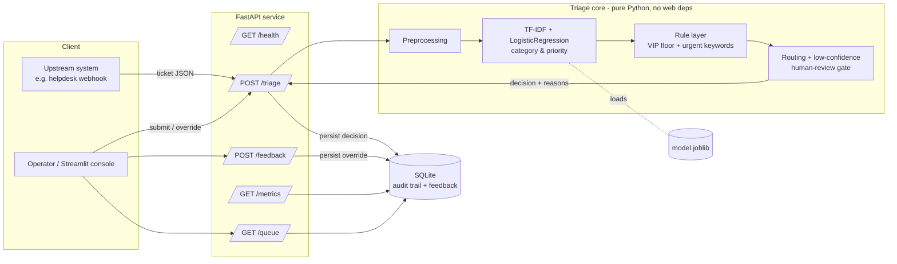
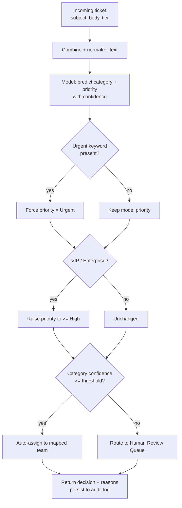
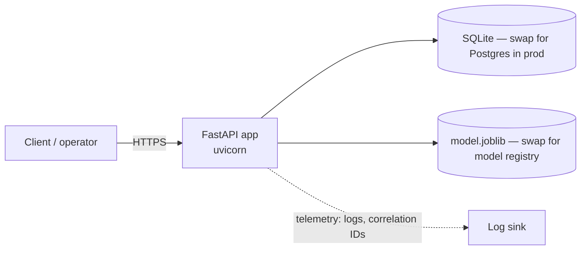

# Architecture

## System overview

## Decision pipeline

## Design principles

- **Core logic is framework-free.** Everything in `app/services/` is pure Python
  with no FastAPI or Streamlit imports, so it is unit-testable in isolation and
  reusable behind any interface.
- **Rules override the model, never the reverse.** The probabilistic model
  proposes; deterministic guardrails (VIP floor, urgent keywords) dispose. This
  is how real triage systems keep safety-critical routing auditable.
- **Low confidence is a first-class outcome.** Below the confidence threshold the
  system withholds auto-assignment and asks a human — a wrong auto-route costs
  more than a short human glance.
- **One table set does triple duty.** The SQLite audit trail is simultaneously
  the explainability record, the feedback/learning loop, and the metrics source.

## Deployment boundaries

